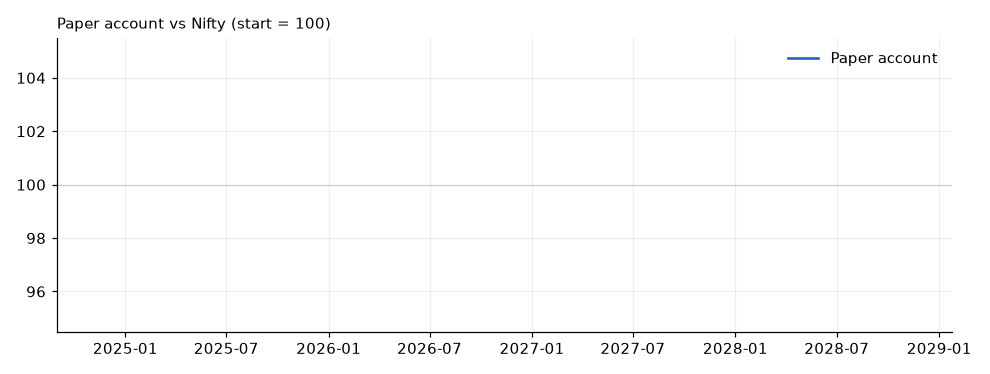
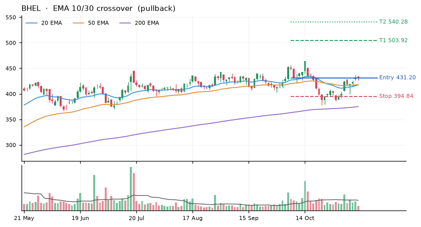
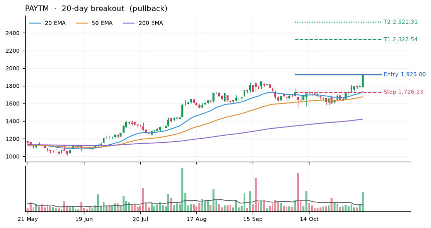
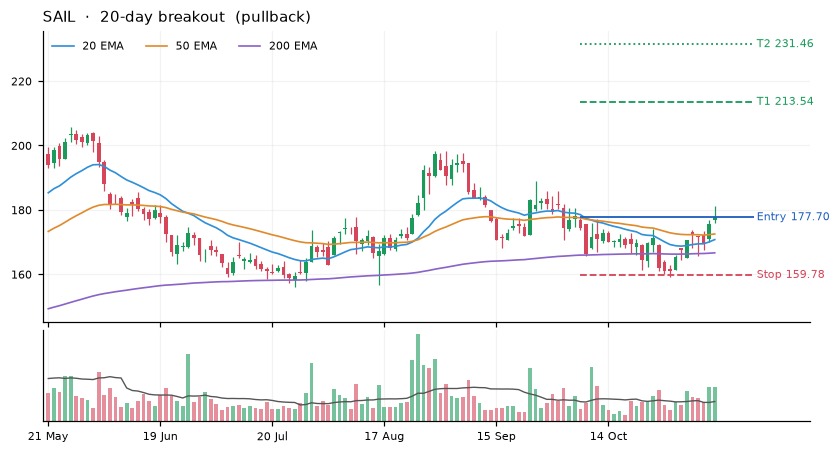
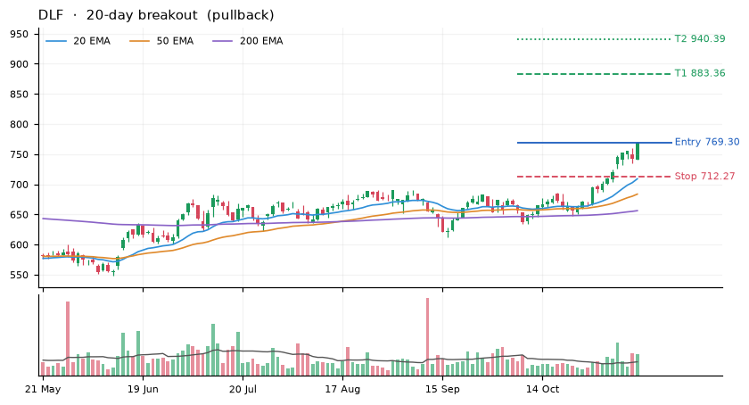
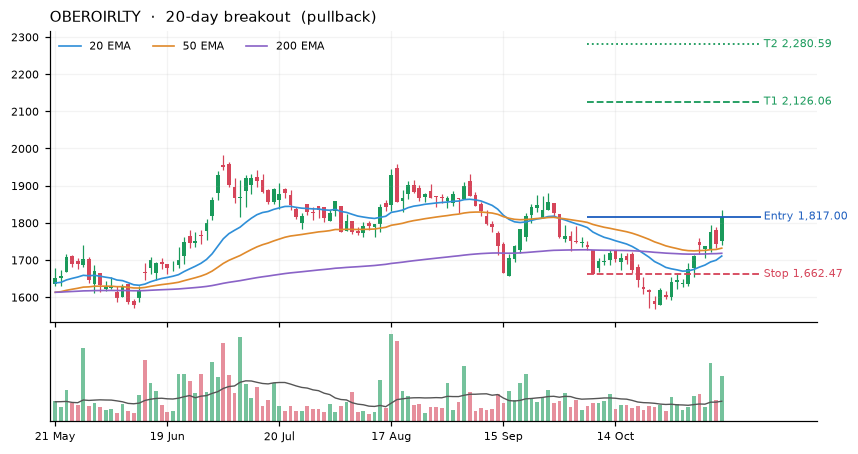
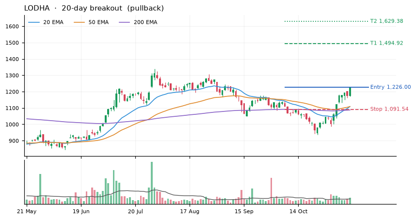

# v5 Paper Trading: Thursday 12 Nov 2026

_Updated automatically 12 Nov 2026 14:15 UTC · version **v5 core** · started 12 Nov 2026_

**Equity ₹100,000** (+0.00%) · Nifty since start +0.00% · open positions 0 · closed trades 0 · max drawdown 0.0%

Market breadth 79% → trend strategies **ON**

## Orders for the next session (buy at the open)

| Stock | Strategy | Qty | Est. entry | Est. stop | Stop % |
|---|---|---|---|---|---|
| BHEL | EMA 10/30 crossover | 38 | 431.20 | 394.84 | 8.40 |
| PAYTM | 20-day breakout | 7 | 1,925.00 | 1,726.23 | 10.30 |
| SAIL | 20-day breakout | 83 | 177.70 | 159.78 | 10.10 |
| DLF | 20-day breakout | 21 | 769.30 | 712.27 | 7.40 |
| OBEROIRLTY | 20-day breakout | 9 | 1,817.00 | 1,662.47 | 8.50 |
| LODHA | 20-day breakout | 11 | 1,226.00 | 1,091.54 | 11.00 |

After the fill, the stop sits the same % below the fill price.

## Open positions

_None._

## Health check vs backtest

_None._

## Recent closed trades

_None._

## Charts
**BHEL**

**PAYTM**

**SAIL**

**DLF**

**OBEROIRLTY**

**LODHA**

## Data notes
- VEDL: 2026-04-30 overnight change -63%, treated as a corporate action and back-adjusted
- TMPV: one-day move over 25% on 2025-10-14 (40%). Check for a split/bonus or bad data.
- TRENT: one-day move over 25% on 2026-01-01 (33%). Check for a split/bonus or bad data.
- POLICYBZR: one-day move over 25% on 2026-09-24 (36%). Check for a split/bonus or bad data.
- Not downloaded: LTIM

_Paper trading only. Not investment advice._
