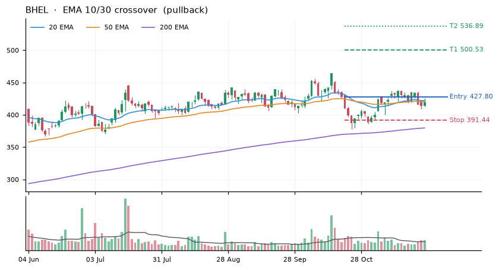
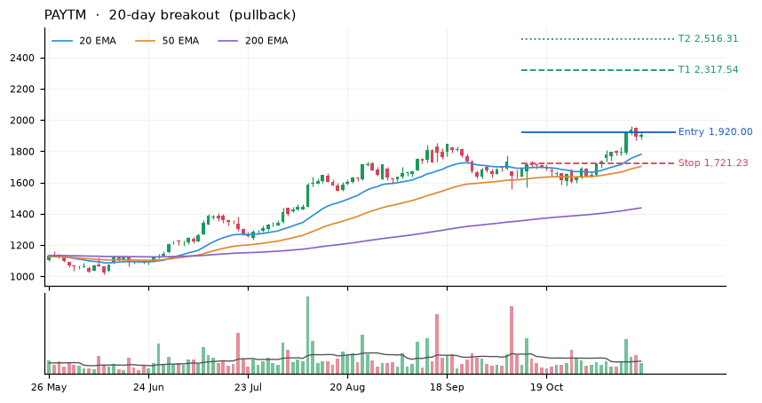

# v5 Paper Trading: Wednesday 18 Nov 2026

_Updated automatically 19 Nov 2026 21:38 UTC · version **v5 core** · started 12 Nov 2026_

**Equity ₹97,918** (-2.08%) · Nifty since start -0.28% · open positions 5 · closed trades 1 · win rate 0% · max drawdown -2.1%

Market breadth 62% → trend strategies **OFF**

## Orders for the next session (buy at the open)

_None._

## Open positions

| Stock | Strategy | Filled | Qty | Fill | Last | Stop | Return % | P&L ₹ | Days left | Exit watch |
|---|---|---|---|---|---|---|---|---|---|---|
| BHEL | EMA 10/30 crossover | 13 Nov | 38 | 427.80 | 421.70 | 391.44 | -1.43 | -252.00 | 56 | EMA10 424.28 vs EMA30 420.64 |
| PAYTM | 20-day breakout | 13 Nov | 7 | 1,920.00 | 1,890.00 | 1,721.23 | -1.56 | -227.00 | 56 | sells on a close below 1696.30 (10-day low) |
| DLF | 20-day breakout | 13 Nov | 21 | 767.00 | 764.30 | 709.97 | -0.35 | -77.00 | 56 | sells on a close below 703.10 (10-day low) |
| OBEROIRLTY | 20-day breakout | 13 Nov | 9 | 1,821.80 | 1,800.00 | 1,667.27 | -1.20 | -217.00 | 56 | sells on a close below 1655.30 (10-day low) |
| LODHA | 20-day breakout | 13 Nov | 11 | 1,224.10 | 1,197.10 | 1,089.64 | -2.21 | -314.00 | 56 | sells on a close below 1036.10 (10-day low) |

## Health check vs backtest

| Strategy | Closed trades | Win % | Expected win % | Avg R | P&L ₹ | Health |
|---|---|---|---|---|---|---|
| 20-day breakout | 1 | 0.00 | 35–46 | -0.73 | -1,091.00 | too early (1/20 trades) |

## Recent closed trades

| Stock | Strategy | Filled | Exited | Exit type | Return % | R | P&L ₹ |
|---|---|---|---|---|---|---|---|
| SAIL | 20-day breakout | 13 Nov 26 | 18 Nov 26 | Exit rule | -7.44 | -0.73 | -1,091.00 |

## Charts
**BHEL**

**PAYTM**

**DLF**

**OBEROIRLTY**

**LODHA**

## Data notes
- VEDL: 2026-04-30 overnight change -63%, treated as a corporate action and back-adjusted
- TMPV: one-day move over 25% on 2025-10-14 (40%). Check for a split/bonus or bad data.
- TRENT: one-day move over 25% on 2026-01-01 (33%). Check for a split/bonus or bad data.
- POLICYBZR: one-day move over 25% on 2026-09-24 (36%). Check for a split/bonus or bad data.
- Not downloaded: LTIM

_Paper trading only. Not investment advice._
