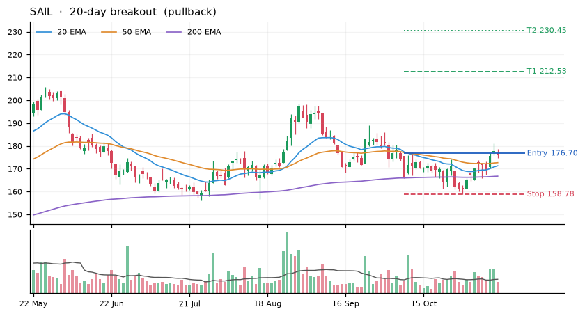

# v5 Paper Trading: Monday 16 Nov 2026

_Updated automatically 17 Nov 2026 21:48 UTC · version **v5 core** · started 12 Nov 2026_

**Equity ₹98,188** (-1.81%) · Nifty since start -0.03% · open positions 6 · closed trades 0 · max drawdown -1.8%

Market breadth 70% → trend strategies **OFF**

## Orders for the next session (buy at the open)

_None._

## Open positions

| Stock | Strategy | Filled | Qty | Fill | Last | Stop | Return % | P&L ₹ | Days left | Exit watch |
|---|---|---|---|---|---|---|---|---|---|---|
| BHEL | EMA 10/30 crossover | 13 Nov | 38 | 427.80 | 430.10 | 391.44 | 0.54 | 67.00 | 58 | EMA10 423.56 vs EMA30 419.88 |
| PAYTM | 20-day breakout | 13 Nov | 7 | 1,920.00 | 1,890.80 | 1,721.23 | -1.52 | -221.00 | 58 | sells on a close below 1629.00 (10-day low) |
| SAIL | 20-day breakout | 13 Nov | 83 | 176.70 | 168.75 | 158.78 | -4.50 | -678.00 | 58 | sells on a close below 161.35 (10-day low) |
| DLF | 20-day breakout | 13 Nov | 21 | 767.00 | 754.75 | 709.97 | -1.60 | -277.00 | 58 | sells on a close below 687.65 (10-day low) |
| OBEROIRLTY | 20-day breakout | 13 Nov | 9 | 1,821.80 | 1,773.60 | 1,667.27 | -2.65 | -454.00 | 58 | sells on a close below 1626.60 (10-day low) |
| LODHA | 20-day breakout | 13 Nov | 11 | 1,224.10 | 1,192.80 | 1,089.64 | -2.56 | -361.00 | 58 | sells on a close below 987.20 (10-day low) |

## Health check vs backtest

_None._

## Recent closed trades

_None._

## Charts
**BHEL**

**PAYTM**

**SAIL**

**DLF**

**OBEROIRLTY**

**LODHA**

## Data notes
- VEDL: 2026-04-30 overnight change -63%, treated as a corporate action and back-adjusted
- TMPV: one-day move over 25% on 2025-10-14 (40%). Check for a split/bonus or bad data.
- TRENT: one-day move over 25% on 2026-01-01 (33%). Check for a split/bonus or bad data.
- POLICYBZR: one-day move over 25% on 2026-09-24 (36%). Check for a split/bonus or bad data.
- Not downloaded: LTIM

_Paper trading only. Not investment advice._
