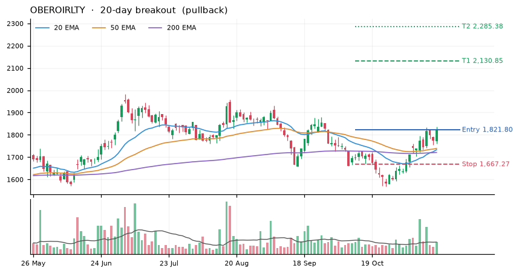

# v5 Paper Trading: Tuesday 17 Nov 2026

_Updated automatically 18 Nov 2026 21:27 UTC · version **v5 core** · started 12 Nov 2026_

**Equity ₹99,273** (-0.73%) · Nifty since start +0.35% · open positions 6 · closed trades 0 · max drawdown -1.8%

Market breadth 68% → trend strategies **OFF**

## Orders for the next session (buy at the open)

_None._

## Open positions

| Stock | Strategy | Filled | Qty | Fill | Last | Stop | Return % | P&L ₹ | Days left | Exit watch |
|---|---|---|---|---|---|---|---|---|---|---|
| BHEL | EMA 10/30 crossover | 13 Nov | 38 | 427.80 | 430.65 | 391.44 | 0.67 | 88.00 | 57 | EMA10 424.85 vs EMA30 420.57 |
| PAYTM | 20-day breakout | 13 Nov | 7 | 1,920.00 | 1,903.40 | 1,721.23 | -0.86 | -133.00 | 57 | sells on a close below 1642.00 (10-day low) |
| SAIL | 20-day breakout | 13 Nov | 83 | 176.70 | 171.31 | 158.78 | -3.05 | -466.00 | 57 | sells on a close below 164.51 (10-day low) |
| DLF | 20-day breakout | 13 Nov | 21 | 767.00 | 765.95 | 709.97 | -0.14 | -42.00 | 57 | sells on a close below 698.55 (10-day low) |
| OBEROIRLTY | 20-day breakout | 13 Nov | 9 | 1,821.80 | 1,819.70 | 1,667.27 | -0.12 | -39.00 | 57 | sells on a close below 1630.00 (10-day low) |
| LODHA | 20-day breakout | 13 Nov | 11 | 1,224.10 | 1,203.10 | 1,089.64 | -1.72 | -248.00 | 57 | sells on a close below 999.90 (10-day low) |

## Health check vs backtest

_None._

## Recent closed trades

_None._

## Charts
**BHEL**

**PAYTM**

**SAIL**

**DLF**

**OBEROIRLTY**

**LODHA**

## Data notes
- VEDL: 2026-04-30 overnight change -63%, treated as a corporate action and back-adjusted
- TMPV: one-day move over 25% on 2025-10-14 (40%). Check for a split/bonus or bad data.
- TRENT: one-day move over 25% on 2026-01-01 (33%). Check for a split/bonus or bad data.
- POLICYBZR: one-day move over 25% on 2026-09-24 (36%). Check for a split/bonus or bad data.
- Not downloaded: LTIM

_Paper trading only. Not investment advice._
